# Aurora Digital Assets

**Bank-Integrated Digital Asset Banking, Risk Operations, API Security, Evidence, and Auditability Prototype**

Aurora Digital Assets is a backend-first local prototype for a bank-integrated digital assets and financial-control architecture. It explores how a Finnish or Nordic banking environment could provide safer, more transparent, and more controlled access to digital assets inside an existing online banking experience, while also adding internal controls for compliance, operational resilience, API security, audit evidence, and review workflows.

The project combines product design, UX, compliance workflows, backend architecture, audit evidence, reporting concepts, deterministic risk/review logic, API security controls, operational resilience scenarios, and local SQLite persistence.

Aurora Digital Assets is not a real bank integration, not a crypto exchange, not a custody provider, not an investment tool, and not financial advice.

---

## Project Status

**Status:** Backend-first local prototype in active development

Current implementation includes:

- React + TypeScript + Vite frontend
- FastAPI backend
- SQLite local persistence
- Backend-first pages with local fallback
- Deterministic payment, withdrawal, and buy/sell evaluation flows
- Audit event integration
- Audit event persistence
- Review case persistence
- Compliance review dashboard
- Risk Operations Console
- API Security Control Center
- Operational Resilience Command Center
- Compliance Intelligence module
- Evidence package preparation and audit-linked evidence generation
- Reporting API
- Internal demo admin seed/reset tools
- Global balance privacy mode
- Bilingual English / Spanish UI foundation
- Basic backend tests with pytest

The project is still a prototype. It does not use real bank APIs, real customer data, real custody systems, real private keys, real payment execution, or real blockchain transactions.

---

## Project Vision

Retail users already access crypto assets through global exchanges, but many users do not fully understand custody, withdrawal risk, tax reporting, compliance obligations, or the difference between holding assets inside a custodial environment and transferring assets to an external wallet.

Aurora Digital Assets proposes a banking-first model:

- Digital assets visible inside online banking
- Clear custody boundaries
- Controlled buy/sell evaluation
- Controlled digital asset invoice payments
- Controlled external wallet withdrawals
- Human-reviewable risk cases
- Audit evidence by design
- API security controls for sensitive actions
- Operational resilience for degraded services and critical dependencies
- Reporting and tax-summary concepts
- User protection through clear warnings and privacy controls

The goal is not to make digital assets feel speculative. The goal is to explore how a bank-style product could make digital asset access more controlled, explainable, resilient, and auditable.

---

## What This Project Is Not

Aurora Digital Assets is:

- Not connected to any real bank
- Not affiliated with Danske Bank, Nordea, OP, S-Pankki, Aktia, OmaSp, Handelsbanken, BancoEstado, or any financial institution
- Not a crypto exchange
- Not a trading platform
- Not a trading bot
- Not a real custody system
- Not a payment processor
- Not an AML or sanctions screening provider
- Not a cybersecurity product in production
- Not financial, legal, tax, or investment advice

All data is fictional or simulated.

---

## Architecture Overview

### Frontend

The frontend is a React banking portal prototype.

Technologies and patterns:

- React
- TypeScript
- Vite
- React Router
- Reusable UI components
- Backend-first service layer
- Local fallback only when backend is unavailable
- Global balance privacy mode
- Bilingual EN/ES UI foundation
- Conservative banking-style UI

Implemented frontend areas include:

- Dashboard
- Accounts
- Payments
- Buy / Sell
- Digital Assets
- Wallet
- Custody
- External Withdrawals
- Bank Staff Workspace
- Customer Access Authorization
- Customer Onboarding
- Financial Crime Monitoring
- Compliance Intelligence
- Evidence Packages
- Operational Resilience
- API Security Control Center
- Risk Operations Console
- Compliance Review
- Reports
- Internal Demo Admin

### Backend

The backend is a local FastAPI prototype.

Technologies and patterns:

- Python
- FastAPI
- Pydantic schemas
- Service-layer architecture
- SQLite local persistence
- Deterministic evaluation services
- Audit event service
- Review case service
- Evidence package service
- Risk operations service
- API security service
- Operational resilience service
- Compliance intelligence service
- Reporting service
- Demo admin service

The backend is intentionally deterministic and auditable. Evaluation flows return explicit decisions, reasons, risk levels, user-facing messages, audit event IDs, correlation IDs, and review case IDs when needed.

### Persistence

The prototype uses SQLite as a local persistence layer.

Current persisted records:

- `audit_events`
- `review_cases`

There is no production migration system yet. SQLite is used to make the local prototype realistic enough for backend-first workflows, audit evidence, reporting, review cases, and demo data control.

---

## Implemented Modules

### Dashboard

The dashboard provides a backend-first financial overview with account summary, digital asset value summary, custody status, risk/protection notices, and backend data loading with local fallback.

### Accounts

The accounts area provides simulated current account details, account balances, recent account activity, connected digital asset balances, and backend account data endpoints.

### Payments

The payments flow supports standard EUR transfer simulation and digital asset invoice payment evaluation. Digital asset payment evaluation is backend-driven and can return decision, risk level, reasons, case ID, estimate, fee data, and user-facing messages.

No real payment is executed.

### Buy / Sell

The buy/sell flow supports BTC and ETH simulated buy/sell evaluation. Backend services return market price, fee, spread, net amount, estimated asset amount, decision, risk level, and optional review case creation.

No real trade is executed. No exchange or custody provider is connected.

### Digital Assets

The Digital Assets module shows supported digital assets, wallet balances, activity records, risk notes, and backend-first data loading.

### Wallet

The wallet view shows simulated digital asset balances, estimated values, custody mode, wallet activity, and backend-first wallet data.

No private keys are created, stored, exposed, or used.

### Custody

The custody page explains internal custodial wallet concepts, private key boundaries, audit trail controls, external withdrawal review controls, and separation between digital assets and bank deposits.

No real custody service is implemented.

### External Withdrawals

The withdrawal flow supports asset/network selection, destination address confirmation, backend risk evaluation, review case creation when required, and audit event creation.

No real blockchain transaction is executed.

### Financial Crime Monitoring

The Financial Crime Monitoring module models internal financial-crime and insider-risk scenarios, including shell company indicators, structured deposits, crypto off-ramp risk, foreign transfer risk, employee-linked account activity, and suspicious growth patterns.

It is deterministic and simulated. It does not perform real AML screening, sanctions screening, entity screening, or transaction monitoring.

### Compliance Intelligence

The Compliance Intelligence module explains risk alerts, reviewer guidance, decision paths, required evidence, and recommended next steps.

It helps demonstrate how a bank could make risk decisions more explainable and reviewable.

### Evidence Packages

The Evidence Packages module prepares simulated evidence packages for internal review.

It supports evidence preparation from:

- Financial crime alerts
- Review cases
- Audit events

Audit-linked evidence packages preserve source audit event ID, correlation ID, backend decision, source module, evidence requirements, and traceability summary.

No real legal, regulatory, PDF, or official evidence package is generated unless explicitly implemented later.

### Operational Resilience

The Operational Resilience Command Center models service health, critical dependencies, fallback modes, incident scenarios, operational controls, paused operations, and continuity decisions.

It demonstrates how Aurora could respond when a critical banking dependency is degraded, while preserving safe operations, pausing sensitive operations, and creating audit evidence.

### API Security Control Center

The API Security Control Center models backend API security controls for sensitive financial actions.

It demonstrates principles such as:

- The interface never decides security
- Authenticated does not mean authorized
- One sensitive operation equals one backend decision and one audit event
- Rate-limit the business action, not only the HTTP request
- Sensitive fields should not be casually exposed in public API contracts
- High-risk operations require stronger verification
- GraphQL batching and multi-operation abuse must be restricted for sensitive workflows

This module does not implement a production GraphQL server. It models deterministic controls and decisions for API security scenarios.

### Risk Operations Console

The Risk Operations Console is an internal command layer that unifies risk actions, operational priorities, escalations, evidence readiness, audit references, and review workflow handoffs.

It can prepare review cases from risk action items and preserve audit event/correlation references.

### Compliance Review

The compliance review dashboard supports backend review case queues, selected case details, evidence timelines filtered by case ID, human reviewer actions, reviewer decision recording, and audit evidence visibility.

This is a simulated operational layer. It does not perform real AML checks, sanctions screening, wallet screening, or regulatory reporting.

### Reports

The reports page consumes backend reporting APIs and shows report summaries, a tax summary concept, audit evidence timeline, review case evidence, and evidence package preparation concept.

No official tax filing or legal reporting is provided.

### Internal Demo Admin

The internal demo admin page supports loading demo status, seeding demo data, and resetting local demo audit/review data.

This is local development/demo tooling only. It is not a production admin system and does not include production authentication or authorization.

---

## Backend API Capabilities

The backend currently supports API areas for:

- Accounts data
- Account transactions
- Connected digital asset balances
- Supported digital assets
- Wallet balances
- Digital asset activity
- Custody status
- Digital asset payment evaluation
- External withdrawal evaluation
- Buy/sell evaluation
- Customer access authorization
- Financial crime monitoring
- Compliance intelligence
- Evidence package preparation
- Audit-linked evidence generation
- Operational resilience scenario evaluation
- API security scenario evaluation
- Risk operations overview and review case preparation
- Review cases
- Audit events
- Reports
- Tax summary concept
- Demo status/reset/seed

Representative endpoints include:

```text
GET  /api/accounts
GET  /api/accounts/{account_id}/transactions
GET  /api/accounts/connected-digital-assets

GET  /api/digital-assets/assets
GET  /api/digital-assets/wallet
GET  /api/digital-assets/activity
POST /api/digital-assets/buy-sell/evaluate

GET  /api/custody/status

POST /api/payments/digital-assets/evaluate
POST /api/withdrawals/evaluate

GET  /api/review-cases
POST /api/review-cases/{case_id}/decision

GET  /api/audit-events

GET  /api/reports
GET  /api/reports/tax-summary/2026
POST /api/reports/evidence-package

GET  /api/financial-crime/risk-scenarios
GET  /api/financial-crime/monitoring-controls
GET  /api/financial-crime/demo-alerts
POST /api/financial-crime/evaluate-demo-activity

GET  /api/compliance-intelligence/risk-explanations
GET  /api/compliance-intelligence/reviewer-guidance
POST /api/compliance-intelligence/explain-alert
POST /api/compliance-intelligence/prepare-review-case

GET  /api/evidence-packages
GET  /api/evidence-packages/templates
GET  /api/evidence-packages/{package_id}
GET  /api/evidence-packages/{package_id}/readiness
POST /api/evidence-packages/generate

GET  /api/operational-resilience/service-health
GET  /api/operational-resilience/dependencies
GET  /api/operational-resilience/fallback-modes
GET  /api/operational-resilience/controls
GET  /api/operational-resilience/incidents
POST /api/operational-resilience/evaluate-scenario

GET  /api/api-security/controls
GET  /api/api-security/events
GET  /api/api-security/surfaces
GET  /api/api-security/sensitive-operations
GET  /api/api-security/scenarios
POST /api/api-security/evaluate-scenario

GET  /api/risk-operations/overview
GET  /api/risk-operations/action-queue
GET  /api/risk-operations/unified-timeline
GET  /api/risk-operations/escalation-summary
POST /api/risk-operations/create-review-case

GET  /api/admin/demo/status
POST /api/admin/demo/reset
POST /api/admin/demo/seed
```

---

## Risk & Review Engine

The prototype includes deterministic evaluation flows for:

- Digital asset invoice payments
- External wallet withdrawals
- Digital asset buy/sell requests
- API security scenarios
- Operational resilience scenarios
- Financial crime indicators
- Risk operations review case preparation
- Evidence package generation

Evaluation responses can include:

- `auto_approved`
- `pending_review`
- `auto_rejected`
- `blocked`
- `escalated`
- `review_required`
- `step_up_required`

Each evaluation can return decision, risk level, reasons, case requirement, case type, case ID, user message, audit event ID, correlation ID, and estimate data when relevant.

Medium-risk or higher-risk actions can create review cases. These review cases appear in the Compliance Review dashboard and are included in reporting/evidence views.

---

## Audit Events and Review Cases

Aurora Digital Assets treats auditability as a core product requirement.

The backend persists:

- Evaluation audit events
- Sensitive action audit events
- Pending review cases
- Risk operations review cases
- Reviewer decisions
- Evidence links between actions, audit events, and cases

The current audit model includes:

- `event_id`
- `timestamp`
- `actor_id`
- `actor_type`
- `source_module`
- `action`
- `object_type`
- `object_id`
- `decision`
- `severity`
- `risk_score`
- `summary`
- `evidence_reference`
- `review_case_id`
- `correlation_id`
- `immutable_note`
- `metadata`
- `persisted`

This allows the prototype to demonstrate how digital asset banking flows and internal risk decisions could be reviewed, explained, persisted, and reported without relying on opaque or speculative logic.

---

## SQLite Persistence

Aurora uses local SQLite prototype storage for selected backend records.

Current SQLite-backed areas:

- Audit events
- Review cases

The storage layer is located in:

```text
backend/app/storage/
```

The current SQLite implementation is intentionally lightweight and does not use Alembic, SQLAlchemy, or production-grade migrations.

This is local prototype persistence only.

---

## Balance Privacy Mode

The frontend includes a global balance privacy mode.

Sensitive financial values are hidden by default and can be revealed using the Show / Hide balances control.

Implemented through:

- `PrivacyModeContext`
- `PrivacyAmount`
- TopBar privacy toggle

This is a user-protection feature for shared or public environments where a user may need to open online banking without exposing balances on screen.

---

## Reporting and Evidence

The reporting module demonstrates:

- Simulated annual digital asset summary
- Simulated tax summary values
- Audit evidence timeline
- Review case evidence
- Evidence package preparation concept
- Audit-linked evidence package generation

Evidence packages can now be prepared from structured audit events, preserving the backend decision, correlation ID, source module, and review context.

No real PDF, CSV, tax filing, bank statement, or regulatory report is generated unless explicitly implemented later.

This is not tax advice.

---

## Internal Demo Admin

The prototype includes an internal demo page:

```text
/admin-demo
```

It can:

- Load local demo status
- Seed representative review cases and audit events
- Reset local demo audit/review data

This helps keep demos repeatable and reduces the need to manually recreate cases through the UI.

The demo admin tool is not production administration. It has no production authentication, authorization, or operational security model.

---

## Repository Structure

```text
agents/                  Development guidance for coding assistants
backend/                 FastAPI backend, services, schemas, SQLite persistence, tests
docs/                    Product, architecture, compliance notes, screenshots
frontend/                React/Vite banking portal frontend
mock-data/               Legacy/local mock data used as fallback or reference
prototypes/              Wireframes and demo scenarios
scripts/                 Development scripts
```

---

## Running Locally

### Backend

```bash
cd backend
python3 -m venv .venv
source .venv/bin/activate
pip install -r requirements.txt
uvicorn app.main:app --reload
```

The backend runs by default at:

```text
http://127.0.0.1:8000
```

### Frontend

```bash
cd frontend
npm install
npm run dev
```

The frontend runs by default at:

```text
http://localhost:5173
```

### Frontend Checks

```bash
cd frontend
npm run lint
npm run build
```

### Backend Compile Check

```bash
cd backend
python3 -m compileall app
```

### Backend Tests

The backend includes basic pytest tests for critical architecture flows.

Install test dependency inside the backend virtual environment if needed:

```bash
cd backend
source .venv/bin/activate
python3 -m pip install pytest
```

Run tests:

```bash
cd backend
source .venv/bin/activate
python3 -m pytest
```

Current test coverage includes:

- API Security scenario evaluation
- Risk Operations review case preparation
- Operational Resilience scenario evaluation
- Evidence package generation from audit event
- Audit events endpoint
- Review cases endpoint
- SQLite persistence behavior

---

## Useful Demo Flow

A useful local demo flow:

1. Start the backend.
2. Start the frontend.
3. Open `/bank-login` and use the demo login flow.
4. Open `/bank-staff`.
5. Open `/bank-staff/api-security` and evaluate an API security scenario.
6. Open `/bank-staff/risk-operations` and prepare a review case.
7. Open `/bank-staff/evidence-packages` and generate evidence from an audit event.
8. Open `/bank-staff/operational-resilience` and evaluate a degraded dependency scenario.
9. Open `/compliance-review` and inspect review cases.
10. Open `/reports` and inspect audit/evidence output.
11. Stop and restart the backend.
12. Confirm persisted audit events and review cases remain available.

---

## Screenshots

Screenshots are stored in:

```text
docs/screenshots/
```

Suggested screenshot filenames:

```text
dashboard.png
accounts.png
payments.png
buy-sell.png
digital-assets.png
wallet.png
custody.png
withdrawals.png
bank-staff.png
api-security.png
risk-operations.png
operational-resilience.png
evidence-packages.png
compliance-review.png
reports.png
admin-demo.png
```

### Dashboard

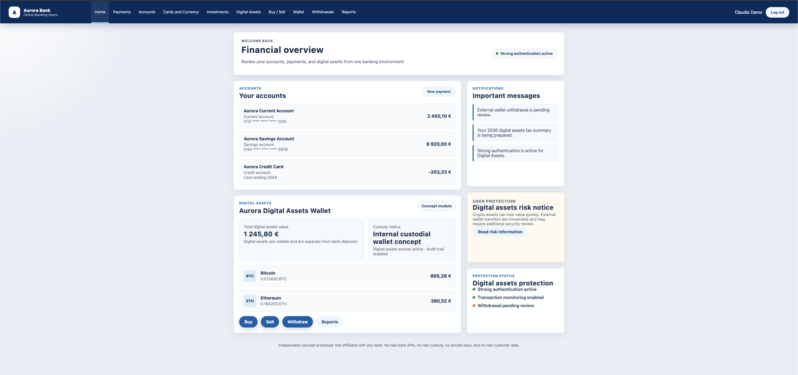

### Payments

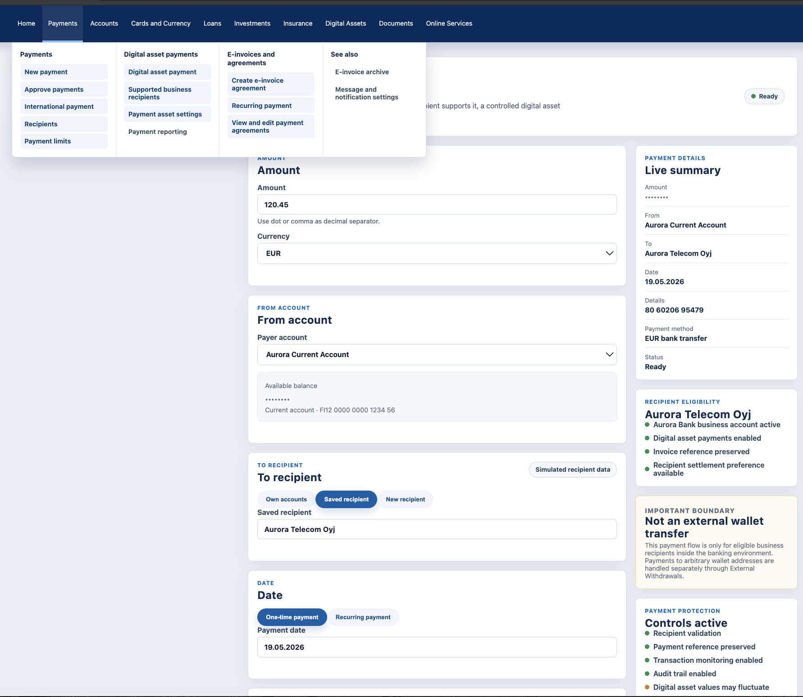

### Buy / Sell

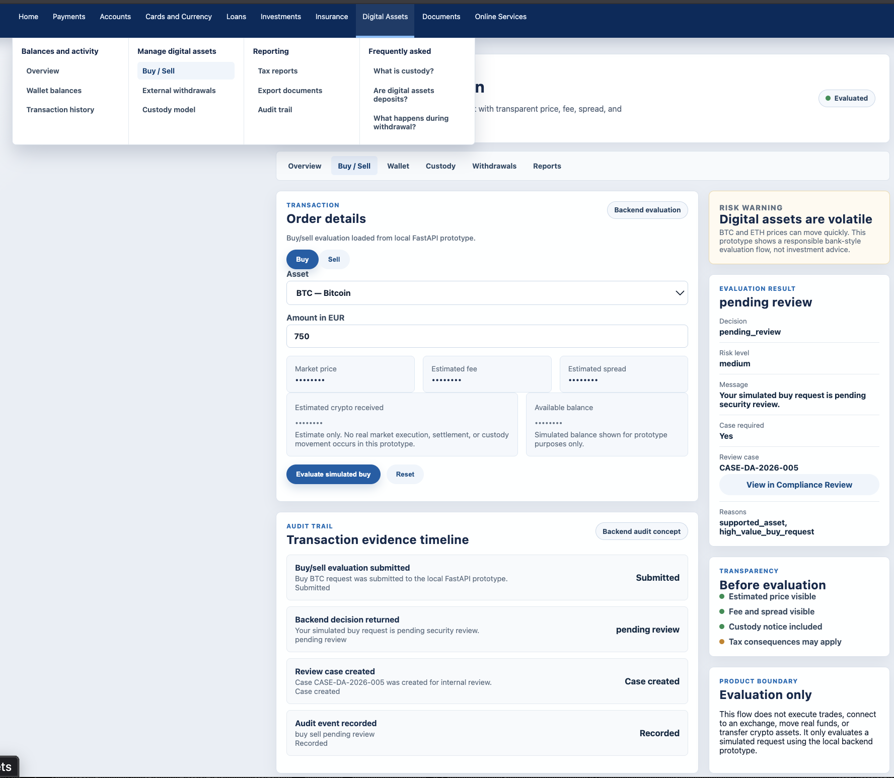

### External Withdrawals

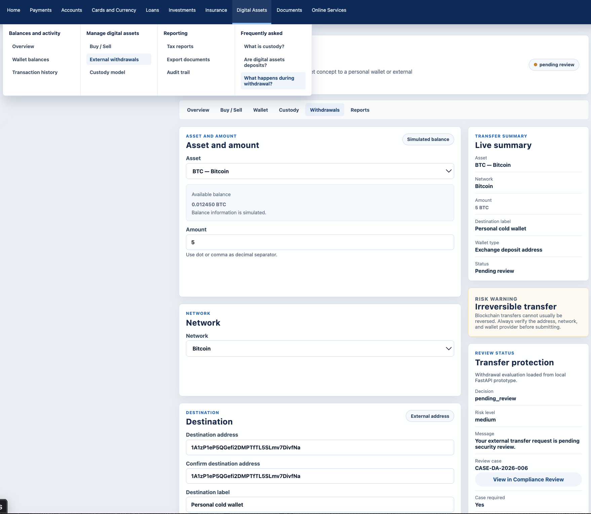

### API Security Control Center

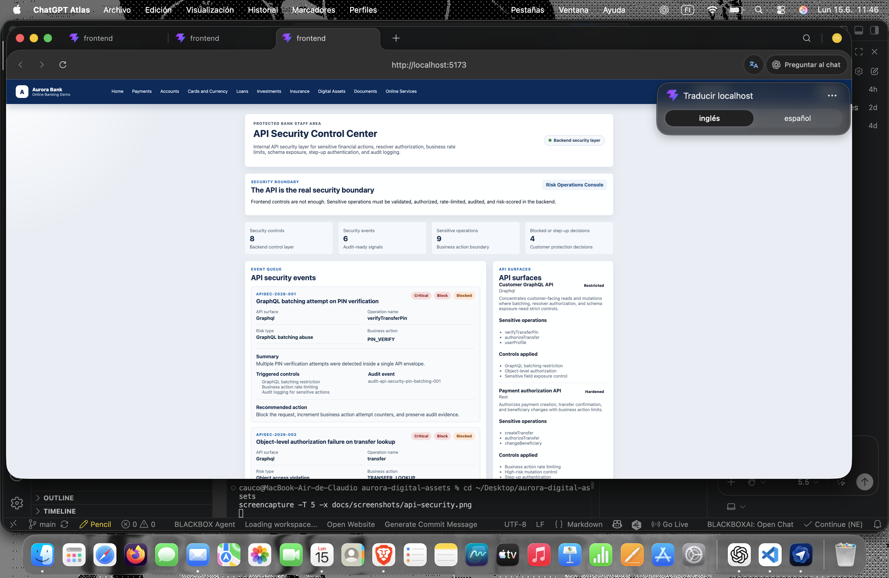

### Risk Operations Console

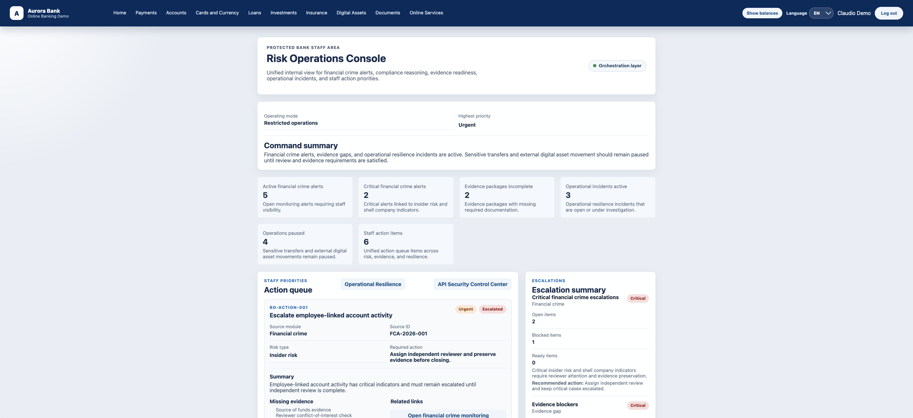

### Operational Resilience

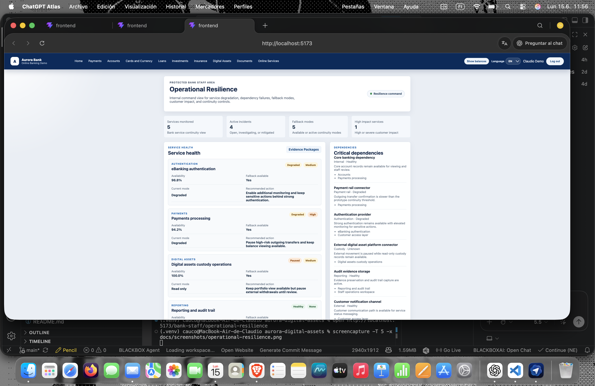

### Evidence Packages

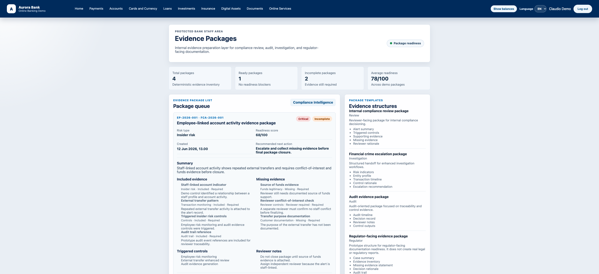

### Compliance Review

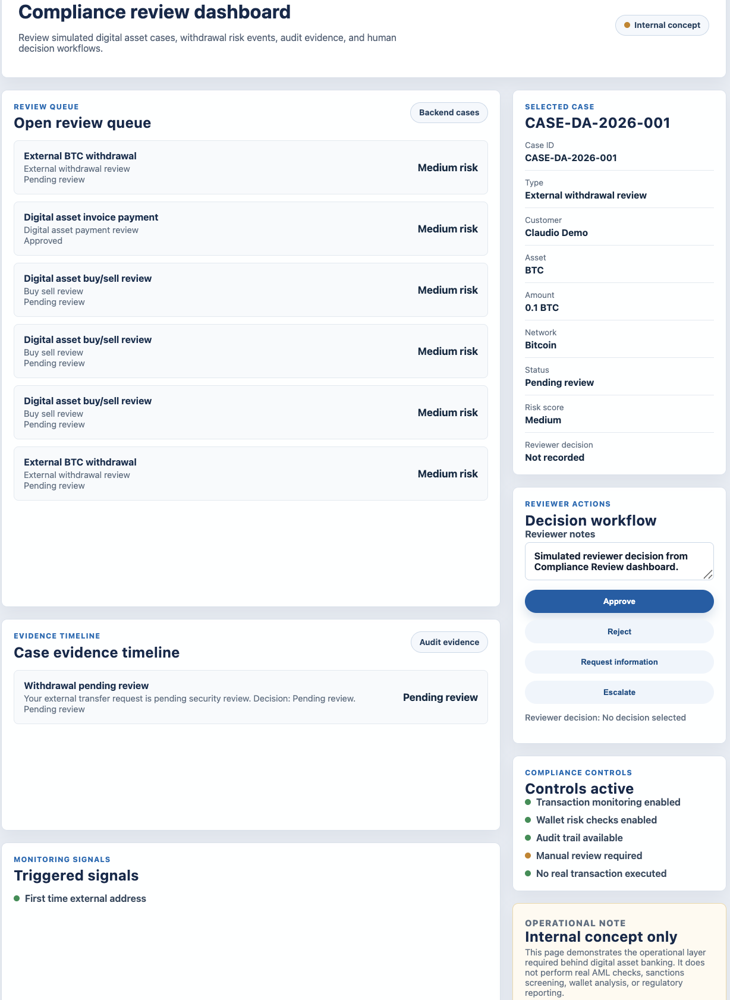

### Reports

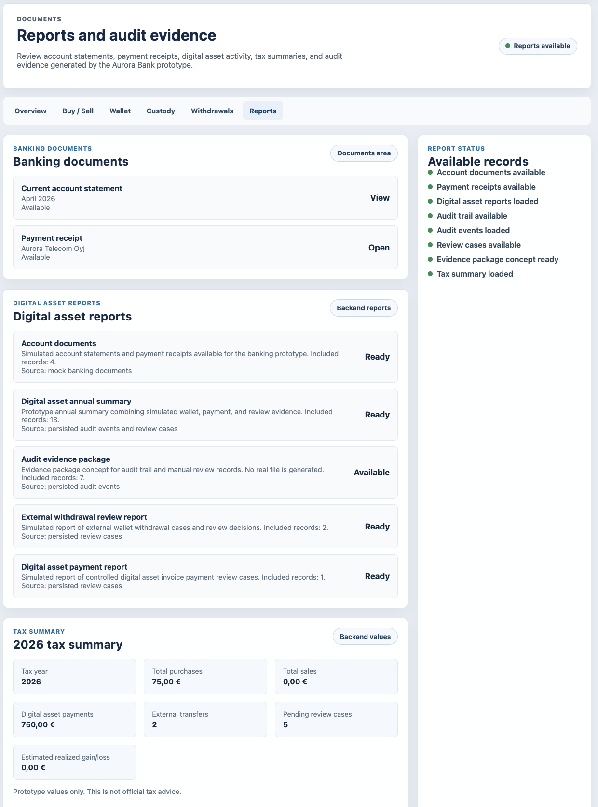

### Internal Demo Admin

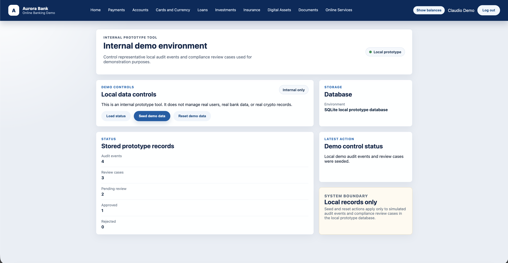

---

## Current Limitations

Aurora Digital Assets currently does not include:

- Real bank integration
- Real customer accounts
- Real payment execution
- Real custody provider integration
- Real private keys
- Real blockchain transactions
- Real exchange integration
- Real market pricing
- Real AML screening
- Real sanctions screening
- Real wallet risk scoring
- Production authentication/authorization
- Production API security middleware
- Production GraphQL implementation
- Production database migrations
- Official tax reporting
- Regulatory reporting
- Production admin tooling
- Production incident management
- Production observability

The demo admin page is local prototype tooling only.

---

## Development Principles

The project follows these principles:

1. **Backend-first**  
   Business decisions, risk outcomes, estimates, audit events, review cases, and evidence package responses should come from backend services where endpoints exist.

2. **Deterministic and auditable**  
   Decisions should be explainable, reproducible, and tied to persisted evidence.

3. **Compliance by design**  
   Review cases, audit trails, and reporting concepts are part of the product architecture, not an afterthought.

4. **Security by architecture**  
   Sensitive actions must be validated in the backend. The frontend must never be treated as the real security boundary.

5. **Operational resilience by design**  
   Critical dependencies, degraded services, fallback modes, paused operations, and audit evidence should be modeled as part of the banking architecture.

6. **User protection**  
   The UI should clearly communicate volatility, custody boundaries, withdrawal risk, review requirements, and reporting limitations.

7. **No fake production claims**  
   The prototype must never imply real execution, real custody, real payment processing, or real regulated financial service delivery.

8. **Minimal mock dependency**  
   Frontend mock data should only be used as local fallback or reference. Backend APIs should be the primary source of truth where implemented.

---

## Security Principles

Aurora follows the following security design principles in prototype form:

- The interface never decides security.
- Every sensitive action must be validated in the backend.
- Authenticated does not mean authorized.
- One sensitive operation equals one backend decision and one audit event.
- Rate limits should apply to business actions, not only HTTP requests.
- Sensitive object access requires object-level authorization.
- Sensitive fields should not be casually exposed in public API contracts.
- High-risk operations must be pausable, reviewable, explainable, and auditable.
- The system should assume client abuse, not client good faith.
- Security, compliance, resilience, and evidence are part of the architecture.

---

## Development Assistance Note

This repository may include guidance files for coding assistants used during development, such as Codex or similar tools.

These files are part of the development workflow only.

Aurora Digital Assets does not use Codex, AI agents, autonomous decision-making, or machine learning as part of the product runtime.

The product logic is designed as deterministic, auditable banking and compliance prototype logic using simulated data.

---

## Related Work

This concept connects with previous projects by the author:

- **WhaleScope Desktop** — crypto market intelligence and on-chain analytics desktop application delivered during internship work with Aalto University.
- **Market Surveillance AI** — deterministic market surveillance, compliance alerts, case management, evidence timelines, and audit-ready reporting.

---

## Author

**Claudio Valenzuela (CAUCO)**

---

## License

Licensed under the Apache License, Version 2.0. See [LICENSE](LICENSE) and [NOTICE](NOTICE).

---

## Disclaimer

Aurora Digital Assets is an independent concept prototype.

It is not affiliated with Danske Bank, Nordea, OP, S-Pankki, Aktia, OmaSp, Handelsbanken, BancoEstado, or any other financial institution.

This project does not provide financial advice, investment recommendations, custody services, banking services, crypto exchange services, payment services, AML services, sanctions screening, tax advice, legal advice, cybersecurity services, incident response services, or regulated financial services.

All data used in the prototype is fictional or simulated.

No real customer data, bank data, private keys, crypto assets, blockchain transactions, payment transactions, or regulated financial records are used.
